<h1 align="center">3mooret EAX</h1>

<p align="center">
  <b>Voice effects, a real mixer and a soundboard for Discord and games on Windows.</b><br>
  Free and open source. Glass design, animated background, Arabic and English.
</p>

<p align="center">
  <a href="https://github.com/3mooret/3mooret-EAX/releases/latest"></a>
  
  
</p>

<p align="center">
  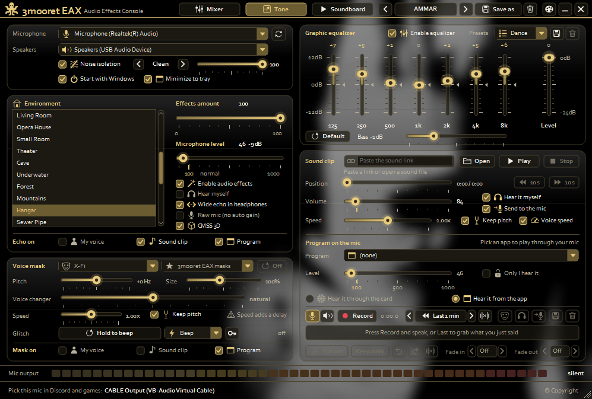
</p>

<p align="center">
  Made by <b>3mooret</b> &bull; <b>AMMAR</b> &bull; Instagram <a href="https://www.instagram.com/064_/"><b>@064_</b></a>
</p>

---

## Why 3mooret EAX

| | |
| --- | --- |
| **Rooms** | 32 echo rooms, from Bathroom and Cathedral to Cave, Hangar and Haunted Cavern |
| **Voice** | 42 voice masks, pitch, size, speed and a glitch pad |
| **Clean mic** | Noise isolation with 5 modes, a 7-band equalizer and a bass control from -12 to +30 dB |
| **Mixer** | A Voicemeeter-style mixer: faders in dB, animated level meters, solo, mono, pan, bass, treble |
| **Sound card** | Pick the input and output, set their Windows volume, choose the buffer size |
| **Programs** | Play the sound of up to **4 programs at once** into your mic |
| **Soundboard** | 12 pads with global hotkeys and a sound library in categories |
| **Recorder** | Keeps the last minutes of what was said or played, with an editor |
| **Look** | Glass theme, rounded cards, animated GIF background, 14 colour themes |
| **Handy** | System tray, remembers your last settings, Arabic (Saudi dialect) |

## Install

1. Download `3mooretEAX-v1.0.0-win64.zip` from the [latest release](https://github.com/3mooret/3mooret-EAX/releases/latest) and unzip it.
2. Run `3mooretEAX.exe`. It offers to set up the free [VB-Audio Virtual Cable](https://vb-audio.com/Cable/) the first time.
3. In Discord or your game, set your input device to **CABLE Output (VB-Audio Virtual Cable)**.
4. Pick a room, raise **Effects amount**, and tick **Hear myself** to hear the result.

Windows may warn about an unsigned program. Click **More info**, then **Run anyway**.

## A look around

<table>
  <tr>
    <td>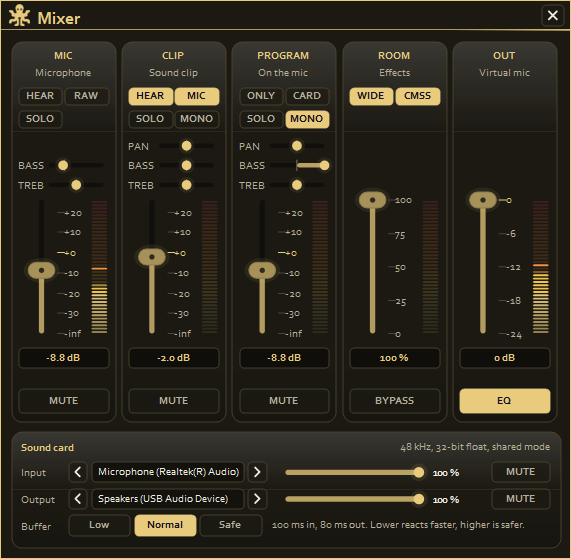</td>
    <td>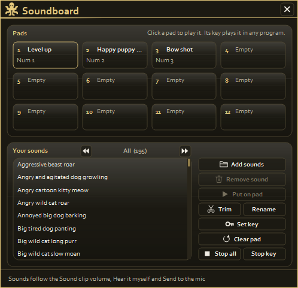</td>
  </tr>
  <tr>
    <td align="center"><b>Mixer</b></td>
    <td align="center"><b>Soundboard</b></td>
  </tr>
  <tr>
    <td>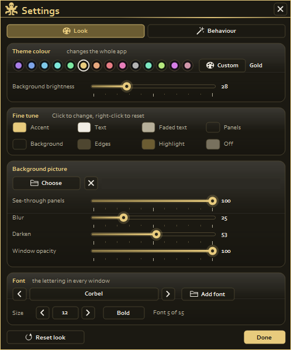</td>
    <td>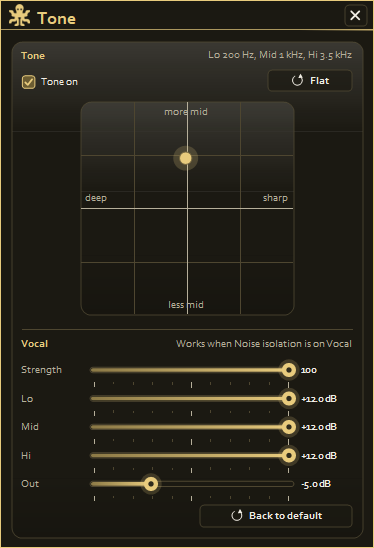</td>
  </tr>
  <tr>
    <td align="center"><b>Look settings</b></td>
    <td align="center"><b>Tone</b></td>
  </tr>
</table>

## What is new in this edition

| Feature | What it does |
| --- | --- |
| Glass theme | Translucent rounded cards over a blurred picture or animated GIF. The default is `res/background.gif`. Replace it with your own (or add `res/background.jpg`) before building, or pick one in Settings, Look |
| Mixer | Strips for the mic, clips, programs, room and output, plus the Sound card panel |
| Several programs on the mic | In **Program on the mic**, click a program to add it and click again to remove it. Up to 4 at once |
| System tray | The minimise and close buttons hide the window to the tray. Right-click the icon for Open and Exit. Turn it off with **Minimize to tray** |
| Bass control | A slider from -12 to +30 dB under the equalizer, added on top of the automatic bass boost |
| Sound library | Funny, Minecraft, Cinematic and Animals, plus your own sounds under **Mine**. Pick a category above the sound list and put any sound on a pad |
| More rooms | 17 new rooms such as Cave, Underwater, Forest, Hangar, Stone Corridor and Robot Room |
| Arabic | Settings, Behaviour, **العربية (Arabic)**. Texts, rooms and masks are translated in the Saudi dialect |
| Last settings | The room, devices, levels and everything else come back as you left them (`%APPDATA%\OctopusEAX\last-session.ini`) |

### Getting the sound library

The sounds are not stored in this repository. Run the script once and it downloads them into `%APPDATA%\OctopusEAX\sounds\<Category>`:

```powershell
powershell -ExecutionPolicy Bypass -File tools\get-sounds.ps1
```

- **Funny, Cinematic, Animals** come from [Mixkit](https://mixkit.co/license/#sfxFree) under its free sound effects licence.
- **Minecraft** sounds are downloaded from Mojang's official asset servers. They belong to Mojang Studios, so keep them for your own use and do not redistribute them.
- [FFmpeg](https://ffmpeg.org) on your PATH converts the Minecraft sounds to MP3. Without it they stay as OGG.

Any folder you add under `sounds` becomes a new category the next time the app starts.

## بالعربي

**3mooret EAX** برنامج مجاني مفتوح المصدر يضيف مؤثرات على صوتك في ديسكورد والألعاب على ويندوز: غرف صدى، أقنعة صوت، عزل ضوضاء، إكوالايزر، ميكسر شبيه بـ Voicemeeter، ولوحة أصوات بمفاتيح تشتغل داخل الألعاب.

- حمّل آخر إصدار من صفحة [Releases](https://github.com/3mooret/3mooret-EAX/releases/latest) وفك الضغط وشغّل `3mooretEAX.exe`.
- اختر المايك والسماعات، واختر في ديسكورد المايك الوهمي **CABLE Output**.
- لتفعيل العربية: الإعدادات ثم السلوك ثم **العربية (Arabic)**.
- أصوات التصنيفات (مضحك، ماين كرافت، سينمائي، حيوانات) تُنزَّل بتشغيل `tools\get-sounds.ps1`.

<p align="center">
  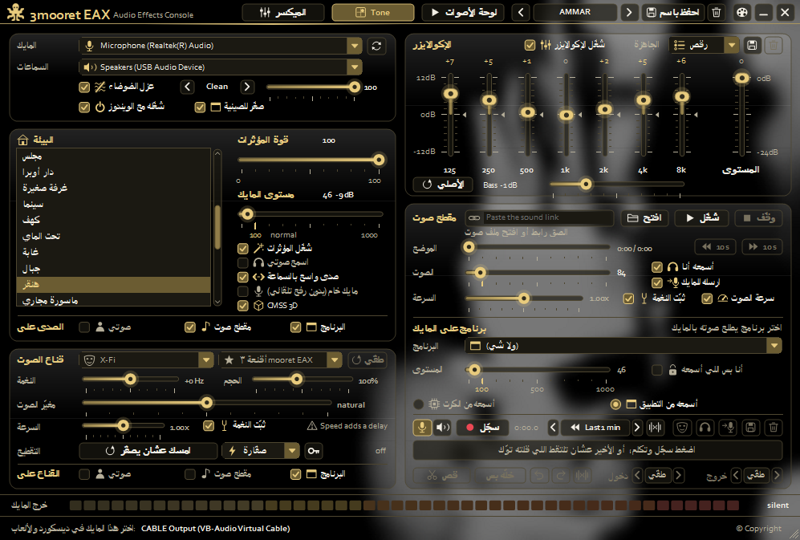
  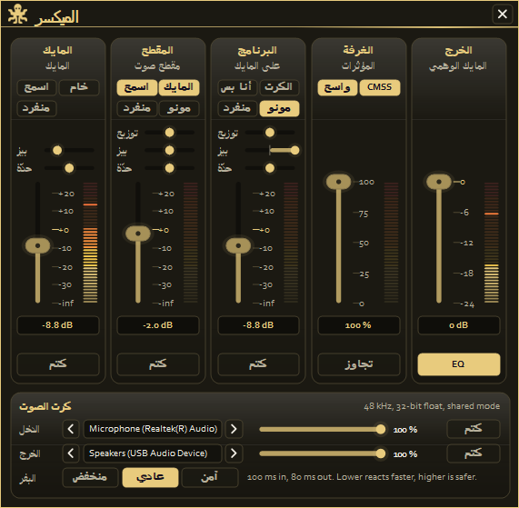
</p>

## Credits

- **Made by:** 3mooret and AMMAR. Instagram [@064_](https://www.instagram.com/064_/)
- **Based on OctopusEAX** by MasonGroup (MIT licence). Contributors and thanks are in the About window of the app. The original release is [here](https://github.com/ALMASONYH/OctopusEAX/releases/download/Release/build.rar).
- Sound effects: Mixkit and Mojang Studios, as described above.

## What you need

- Windows 10 or 11, 64-bit
- A microphone
- VB-Audio Virtual Cable (free). 3mooret EAX offers to set it up the first time you open it.

## Getting started

1. Open 3mooret EAX. It opens straight into the main window.
2. Pick your microphone and your speakers or headphones at the top left.
3. In Discord or your game, set your input device to the mic shown at the bottom of the window, **What U Hear (VB-Audio Virtual Cable)**.
4. Pick a room and raise **Effects amount**. Tick **Hear myself** to hear the result.

Rest the mouse on any control and a short hint tells you what it does.

## The main window

### Top bar


A setup keeps every setting on the main window. Save one with **Save as**, then switch between your setups with the arrows or with a hotkey.

### Microphone, speakers and noise isolation

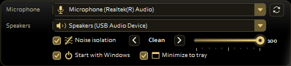

Noise isolation cuts room noise, keyboard clicks and other voices out of your mic.

- **Vocal** is a voice gate with its own low, mid and high lift. Its settings are in the Tone window.
- **Gate** only shuts the mic between words.
- **Clean**, **Studio** and **Broadcast** also clean up the sound.

Higher values cut more noise but can clip quiet words. For Vocal, 50 is the normal strength.

### Rooms

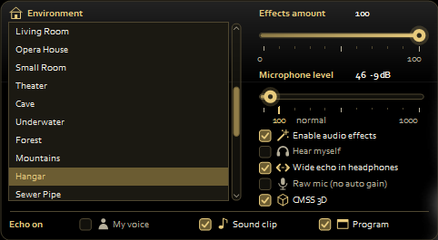

Pick a room from the list. **Effects amount** sets how much echo others hear: 0 turns it off, and above 50 the echo starts to cover your voice.

Under **Echo on**, choose what goes through the room: your voice, sound clips, the program's sound, or any mix of them.

If your voice keeps getting louder and quieter by itself, try **Raw mic**.

### Voice mask

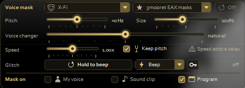

Pick a mask from either list, then fine-tune it with pitch, size, the voice changer and speed.

Hold **Hold to repeat** to glitch your voice. The list next to it picks the glitch style, and the key button sets a key that holds the glitch from any program.

### Equalizer

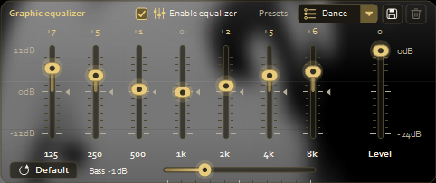

The equalizer shapes everything that goes to the mic. Drag a band up or down, and double-click it to put it back to 0. Save your own bands as a preset.

### Sound clip

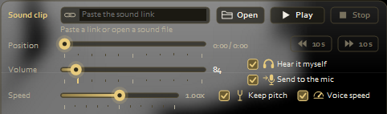

Paste a link or open a sound file, then press **Play**. Tick **Send to the mic** so others hear it, and **Hear it myself** to hear it too.

### Program on the mic

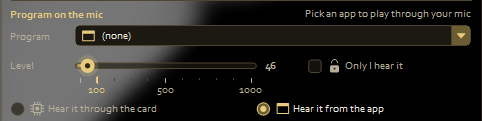

Pick a running game or app, and its sound goes into your mic. With **Only I hear it**, the sound stays in your headphones and never reaches the mic.

### Recorder

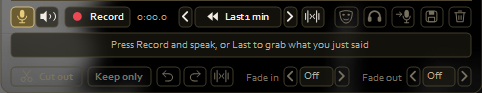

- **Record** records your voice with the effects, what you hear, or both at once.
- **Last** keeps the last part of what was said or played all the time, from 5 seconds up to 10 minutes, and puts it into the editor with one click.
- In the editor, click the wave to play from that point. Drag across it to pick a part, then cut it out or keep only that part.
- When you're done, send the recording to the mic, or save it as MP3, WAV, M4A, WMA or FLAC.

Ctrl+Z and Ctrl+Y undo and redo.

### Bottom bar

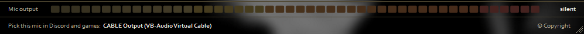

The meter shows what goes into the mic. Drag the corner of the window to make it bigger or smaller, and double-click the corner to go back to the normal size.

## Mixer


One strip each for the mic, sound clips, programs, the room and the output. Every strip has a fader in dB, a level meter and a mute button. The mic, clip and program strips also have solo, bass and treble, and the clip and program strips have mono and pan. The **Sound card** panel at the bottom picks the input and output devices, sets their Windows volume and chooses the buffer size.

## Tone window


Move the dot to make your voice deeper or sharper, with more or less middle. The **Vocal** part sets the Vocal noise isolation: how hard it cuts, the low, mid and high lift, and its output level.

## Soundboard


Add your sound files and put them on pads. Click a pad to play it, or give it a key that plays it from any program, even in a game. Pads follow the Sound clip volume, **Hear it myself** and **Send to the mic**.

## Settings

### Look


Change the colours, use your own background picture, make the window see-through, and pick the font.

### Behaviour and hotkeys

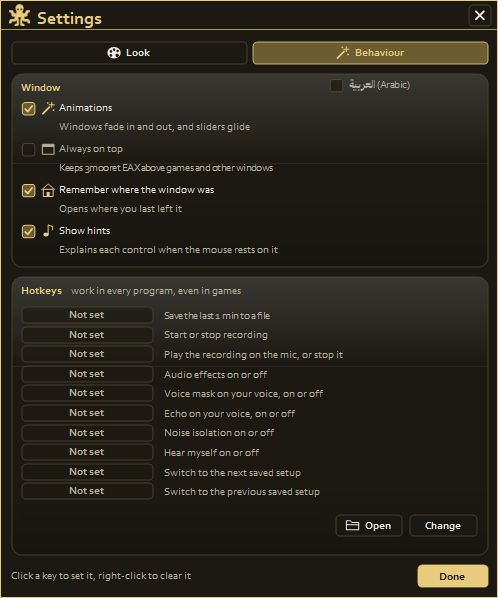

Hotkeys work in every program, even inside games. Click a key box and press the keys you want; right-click a box to clear it. Keys already used by the soundboard, the glitch or another program are refused.

## Building from source

1. Install Visual Studio 2026 with the **Desktop development with C++** workload.
2. Open `MasonEAX.sln`.
3. Choose **Release** and **x64**, then build.
4. The program is `build\MasonEAX\3mooretEAX.exe`.

| Folder | What is in it |
| --- | --- |
| `src/app.cpp`, `src/ui` | The window, the controls, fonts and the audio path |
| `src/reverb`, `src/presets` | The rooms |
| `src/voice` | Masks, pitch, speed and the glitch |
| `src/isolation` | Noise isolation |
| `src/equalizer` | The equalizer |
| `src/playback` | Sound clips, the soundboard, the recorder and program sound |
| `src/mixing`, `src/convolution`, `src/audio` | Levels, mixing and audio buffers |
| `src/cable` | VB-Audio Virtual Cable setup |
| `res` | The icons and the pictures |

## For developers

Everything below is plain C++ tables and numbers. Change a number, rebuild, and listen.

### Where the echo is

| File | What is in it |
| --- | --- |
| `src/presets/card_presets.hpp` | `CARD_PRESETS`, the 15 rooms in the order the room list shows them, and the extra Haunted Cavern tables |
| `src/reverb/reverb_params.hpp` | `eax::Params`, the fields every room row fills in, in order |
| `src/reverb/reverb_engine.hpp` | `eax::EAXReverb`, the engine that plays every room |
| `src/reverb/card_core.hpp` | `eax::CardCore`, the core room of Haunted Cavern, which is the echo others hear in that room |
| `src/mixing/amount_law.hpp` | `AmountLaw`, how **Effects amount** turns into levels |
| `src/mixing/send_level.hpp` | `SendLevel`, which splits off the loud parts of your voice for Haunted Cavern |
| `src/mixing/echo_tap.hpp` | `EchoTap`, the single clear repeat in Haunted Cavern's wide headphone room |
| `src/app.cpp` | `audioThread()` sends your voice into the room and mixes it back, and `DEFAULT_PRESET` is the room picked on the first start |

### Changing a room

A row in `CARD_PRESETS` is the room's name followed by its settings. The first 20 numbers are the same for every room:

| # | Field | What it does |
| --- | --- | --- |
| 1 | `density` | How big the room is, 0 to 1. It stretches the room's delay lines |
| 2 | `diffusion` | How smooth the tail is, 0 to 1. Low values sound grainy |
| 3 | `gain` | Overall level of the room, 1.0 is full |
| 4 | `gainHF` | Level of the highs at `hfReference`. Lower is darker |
| 5 | `gainLF` | Level of the lows at `lfReference` |
| 6 | `decayTime` | Seconds the tail takes to fall away (60 dB) |
| 7 | `decayHFRatio` | How long the highs last compared with `decayTime` |
| 8 | `decayLFRatio` | How long the lows last compared with `decayTime` |
| 9 | `reflectionsGain` | Level of the first echoes off the walls |
| 10 | `reflectionsDelay` | Seconds before the first echo |
| 11 | `lateReverbGain` | Level of the long tail |
| 12 | `lateReverbDelay` | Seconds between the first echo and the tail |
| 13 | `echoTime` | Seconds between repeats of the echo |
| 14 | `echoDepth` | How strongly the echo repeats, 0 to 1 |
| 15 | `modulationTime` | Speed of the slow wobble in the tail, in seconds per cycle |
| 16 | `modulationDepth` | Depth of that wobble, 0 to 1 |
| 17 | `airAbsorptionGainHF` | How much the air dulls the highs, 1.0 is not at all. Only used when `decayHFLimit` is 1 |
| 18 | `hfReference` | The frequency in Hz that "highs" means above |
| 19 | `lfReference` | The frequency in Hz that "lows" means below |
| 20 | `decayHFLimit` | 1 lets the air shorten the highs, 0 doesn't |

Levels are plain multipliers, so 1.0 means unchanged and 0.5 is about 6 dB quieter. For example, to make Bathroom ring longer, change its `decayTime` from `1.49` to `2.5`.

To add a room, add a new row at the end of `CARD_PRESETS`. The list in the app grows by itself. Saved setups remember a room by its place in the list, so a row added in the middle would move every room after it. `HAUNTED_CAVERN_INDEX` must stay the place of the Haunted Cavern row (8, counting from 0).

### Haunted Cavern

Haunted Cavern is the echo the Sound Blaster Live! 24-bit External (SB0490) is known for. Its parts only run while it is the picked room (`curPreset == HAUNTED_CAVERN_INDEX` in `audioThread()`).

What others hear, and what you hear with **Hear myself**, is your voice plus the **core room**. Ticking **Wide echo in headphones** adds a wider stereo room in your headphones only; it never reaches the mic.

| Part | Where | What it does |
| --- | --- | --- |
| Core room | `HC_CORE` in `src/presets/card_presets.hpp`, played by `eax::CardCore` | The card's own centre sound, the part listeners know, and the only echo that goes to the mic. In order: room level in dB, highs in dB (`-15.0`), decay in seconds (`17.01`), highs decay ratio, reflections dB, reflections delay, tail dB, tail delay, size, diffusion, air dB, echo depth, echo time, wobble depth, wobble time, highs frequency in Hz, highs limit |
| Loud voice | `HC_LOUD_DECAY`, with the split in `SendLevel` (`src/mixing/send_level.hpp`) | When your voice goes above about -4 dB (`THRESHOLD_DB`), the loud part goes to a second core room that fades over `15.0` seconds |
| Levels | `AmountLaw` in `src/mixing/amount_law.hpp` | How **Effects amount** sets the core room and the wide room, and how much your own voice is lowered so the echo can cover it |
| Wide room | The `"Haunted Cavern"` row in `src/presets/card_presets.hpp` | Headphones only, with **Wide echo in headphones** ticked. Its `decayTime` is `15.6678` seconds. The fields after the first 20 (`lineScale`, the short echoes, `earlyDecay`, the EQ bands and others, named in `reverb_params.hpp`) fine-tune it to the card |
| Early echoes | `HC_REFLECTIONS` in the same file | The wide room's 59 echoes in the first 0.6 seconds. Each line is the time in milliseconds, the left level and the right level |
| Tail feed | `HC_CORE_FEED` | The taps that feed the wide room's long tail. Each line is the time in milliseconds and the level |
| The repeat | `EchoTap` in `src/mixing/echo_tap.hpp`, with its time and level in `AmountLaw` | The wide room's single clear repeat, about half a second after you speak |
| The card's own recording | `haunted_cavern_ir.wav` next to `3mooretEAX.exe` | Optional. If the file is there when the sound starts, a recording of the real card's response replaces the model, mic included (`src/convolution`). Restart 3mooret EAX after adding it |

Some changes you can make:

- **A longer or shorter echo:** for what others hear, change the core room's decay (`17.01` in `HC_CORE`) and `HC_LOUD_DECAY` (`15.0`). For the wide room, change the row's `decayTime` (`15.6678`) and `earlyDecay` (`15.65`). With **Wide echo in headphones**, loud parts also go to a second wide room whose decay is `decayTime` × `HC_LOUD_DECAY` ÷ the core decay (about 13.8 seconds), so changing `17.01` or `15.0` changes that tail too.
- **Brighter or darker:** change the core room's highs (`-15.0` in `HC_CORE`). Closer to 0 is brighter.
- **When the repeat comes:** `SLAP_SEC` (`0.4867` seconds) holds up to amount 20 (`SLAP_SLIDE_FROM`), then the repeat moves to `SLAP_SEC_FULL` (`0.4733`) at 100. `EchoTap` holds at most half a second (`MAX_SECONDS`).
- **How loud the repeat is:** from about amount 11 up it is `SLAP_MAX`. Below that, `SLAP_CAL` and `SLAP_EXP` shape it.
- **How fast the echo covers your voice:** up to `RISE_FROM` (10) your voice is not lowered. Above it, the gap the code aims for between the echo and your voice grows to 2 × `GAP_DB` (22 dB) at 100, and `GAP_EXP_NEAR` and `GAP_EXP_FAR` shape the curve.

### Voice masks

All the masks are in `MASKS` in `src/voice/voice_masks.hpp`, one row each:

```cpp
{L"Demon", 600, 148, FX_NONE, 0.0, 0.0},
```

| Value | What it does |
| --- | --- |
| name | The name shown in the list |
| ratio | Pitch in thousandths: 1000 keeps your pitch, 2000 is an octave up, 500 an octave down. From 400 to 2500 |
| size | The size of the voice in percent: 100 keeps it, more sounds bigger and darker, less sounds smaller. From 60 to 150 |
| fx | The extra effect from the `FxKind` list at the top of the file, or `FX_NONE` |
| a, b | The effect's two settings, used by the X-Fi effects below |
| anchor | Optional. Puts every voice on the same pitch and colour, whoever speaks. Only Stranger uses it: `{on, spread, follow, rough}` |

Picking a mask sets its ratio, moves the **Size** slider to its size, and puts **Pitch** and **Voice changer** back to 0 (`pickMask` in `src/app.cpp`). **Pitch** is an extra shift in Hz on top of the ratio. Pitch and size are made by `src/voice/voice_shaper.hpp`, and the effects by `src/voice/voice_fx.hpp`.

To change a mask, change its numbers. For example, Demon gets deeper with a ratio of `520` instead of `600`.

#### The X-Fi masks

The first 18 rows of `MASKS`, from Alien Brute to Unstable, are the masks of the X-Fi (Flash version). `NUM_XFI_MASKS` is how many there are, and they fill the **X-Fi** list. Neutral (`MASK_NEUTRAL`, row 13 counting from 0) changes nothing. When it is picked, the closed box shows X-Fi.

Their effects use `a` and `b` like this, in `src/voice/voice_fx.hpp`:

| fx | a | b | Function |
| --- | --- | --- | --- |
| `FX_RING` | Ring frequency in Hz | Mix, 0 to 1 | `ring()` |
| `FX_TREMOLO` | Speed in Hz | Depth, 0 to 1 | `tremolo()` |
| `FX_RADIO` | Drive. The sound is also cut to 500-2700 Hz | Not used | `radio()` and `designRadio()` |
| `FX_VIBRATO` | Speed in Hz | Depth, 1.0 swings 4.5 ms | `vibrato()` |

For example, Robot is `{L"Robot", 1000, 100, FX_RING, 75.0, 1.00}`: your own pitch, ringing at 75 Hz at full mix.

#### The 3mooret EAX masks

The rows after the X-Fi masks fill the **3mooret EAX masks** list. `OWN_ORDER` sets their order in that list by row number. Each one has its own effect: `VoiceFx::start()` sets it up and `VoiceFx::own()` runs it, both in `src/voice/voice_fx.hpp`.

To add a mask, add a row at the end of `MASKS` and put its row number in `OWN_ORDER` where it should appear. Saved setups remember a mask by its row number, so new rows go at the end. For a new effect, add its name to the end of `FxKind`, then a `case` for it in `start()` and in `own()`.

---

Glass Edition modified by 3mooret &bull; AMMAR &bull; [@064_](https://www.instagram.com/064_/)

Original project &copy; 2026 MasonGroup (MIT licence). This edition &copy; 2026 coda Group. Join our Discord: https://discord.gg/8c4JqV64xA
